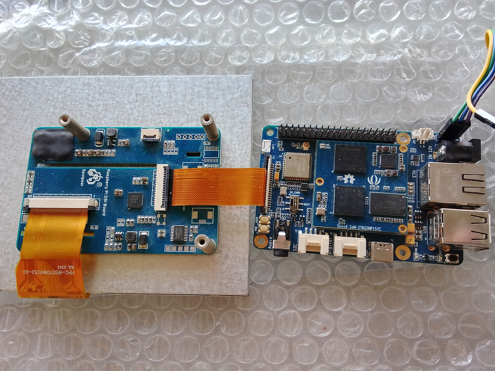
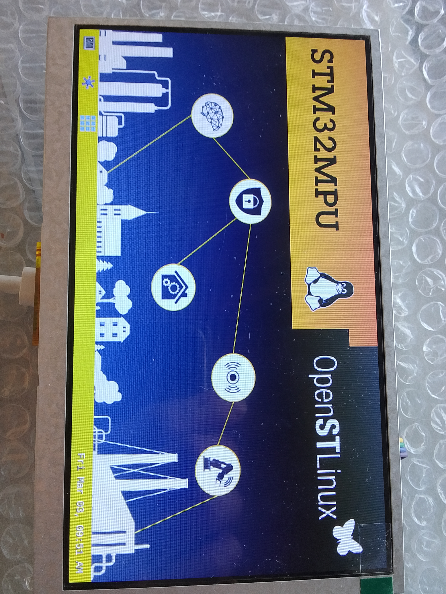
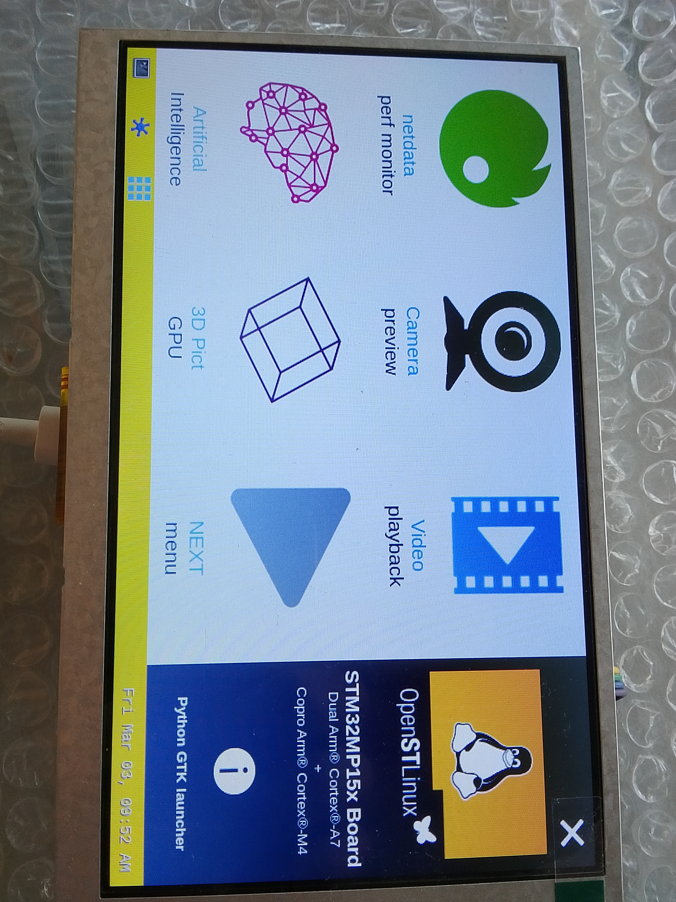

# How To Start

This project is a custom fork of the official [Seeed-Studio/meta-st-odyssey](https://github.comSeeed-Studio/meta-st-odyssey.git) repository. 

It has been modified to include build support for the Raspberry Pi 7-inch MIPI DSI Touchscreen Display (including custom kernel drivers, Device Tree updates for `stm32mp157c-odyssey.dts`, and mandatory Kconfig features).

## 1. Clone repositories

```bash
git clone https://github.com/ltaparkrunner/meta-st-odyssey.git -b openstlinux-6.1-yocto-mickledore
git clone https://gerrit.googlesource.com/git-repo
./git-repo/repo init -u https://github.com/STMicroelectronics/oe-manifest.git -b refs/tags/openstlinux-6.1-yocto-mickledore-mpu-v24.06.26
./git-repo/repo sync
```

## 2. Set Env

```bash
export READTIMEOUT=0; DISTRO=openstlinux-weston MACHINE=stm32mp1 source layers/meta-st/scripts/envsetup.sh --pkg-update --no-ui
```

> 💡 **Note:** If the command above does not work, use the shorter version without the `--no-ui` flag:
> ```bash
> export READTIMEOUT=0; DISTRO=openstlinux-weston MACHINE=stm32mp1 source layers/meta-st/scripts/envsetup.sh --pkg-update
> ```

## 3. Add meta-st-odyssey layer

```bash
bitbake-layers add-layer ../meta-st-odyssey
```

## 4. Build project

```bash
bitbake st-image-weston
```

## 5. Make image

```bash
cd tmp-glibc/deploy/images/stm32mp1
./scripts/create_sdcard_from_flashlayout.sh flashlayout_st-image-weston/optee/FlashLayout_sdcard_stm32mp157c-odyssey-optee.tsv
```

## Hardware and Results

### Connection Diagram


### Working Screen Examples


